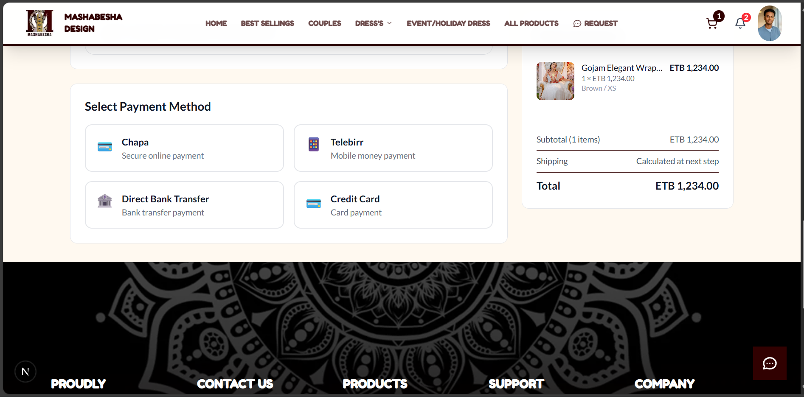
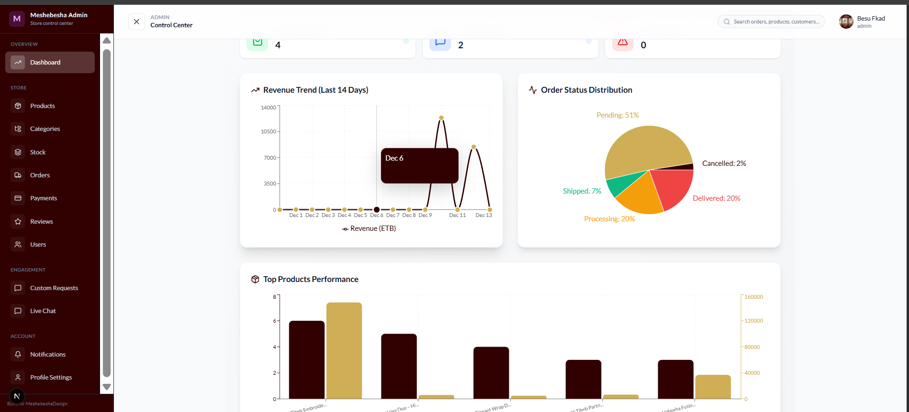
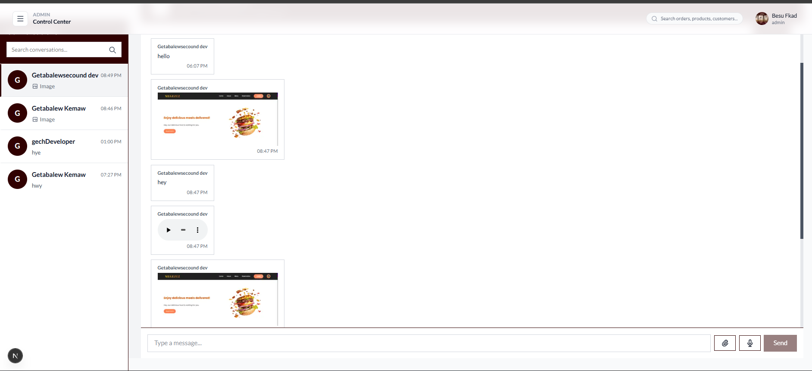
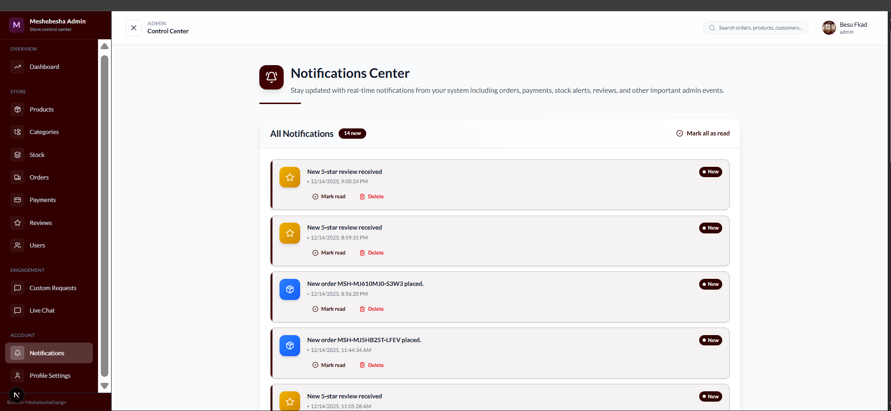
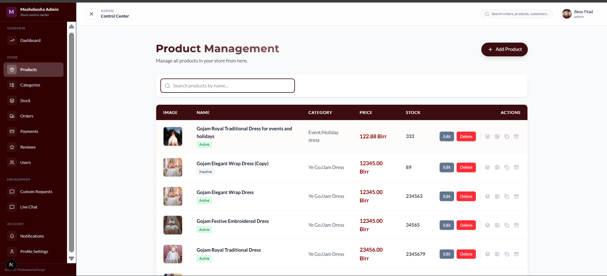

# 🛍️ Meshebesha Design - Enterprise E-Commerce Platform


> **Where Tradition Meets Innovation.**  
> A state-of-the-art, full-stack e-commerce ecosystem engineered for high-performance retail. Built solely for **Meshebesha Design**, this platform seamlessly integrates complex inventory management, real-time analytics, and secure payment processing into an elegant, user-centric shopping experience.

---

## 🚀 Executive Summary

**Meshebesha Design** is not just an online store; it is a **comprehensive digital retail operating system**. It automates the entire lifecycle of an order—from the moment a customer lands on the site to the final delivery and review.

Built on a **Next.js 16** and **Express.js 5** micro-service inspired architecture, it features **Better Auth** for bank-grade security and **Socket.io** for real-time customer engagement.

---

## � Core Capabilities

### 🛒 1. Advanced Customer Experience (Storefront)
Designed to convert visitors into loyal customers through an intuitive and fast interface.
*   **Dynamic Product Catalog:** Users can filter thousands of products by category, price, size, and color variants instantly.
*   **Smart Search:** Real-time search functionality that finds products as you type.
*   **Seamless Cart & Checkout:** A friction-less checkout process optimized for mobile and desktop, supporting guest checkout and saved user addresses.
*   **Custom Product Requests:** A unique module allowing customers to upload designs/media and request custom-made clothing directly through the platform.


### 💳 2. Financial & Order Infrastructure
Robust systems to handle transactions and order lifecycles reliably.
*   **Secure Payment Gateway:** Native integration with **Chapa** for secure, localized payment processing.
*   **Automated Order Tracking:** Customers can track their order status (Pending, Processing, Shipped, Delivered) in real-time.
*   **Invoice Generation:** Automatic generation of digital order summaries and invoices.



### 📊 3. Enterprise-Grade Admin Dashboard
A command center for business owners to manage operations without technical expertise.
*   **Real-Time Analytics:** Visualize sales trends, revenue, and visitor traffic live.
*   **Order Management:** Process orders, print shipping labels, and manage returns/refunds from a single interface.
*   **Inventory Control:** Manage complex product variants (Size/Color/Material), track low stock, and bulk update prices.
*   **Media Management:** Drag-and-drop upload for high-resolution product images and videos via Cloudinary.



### 💬 4. Real-Time Engagement & Support
Bridging the gap between online and in-store service.
*   **Live Customer Chat:** Admin can chat directly with visitors to answer questions and close sales instantly.
*   **Voice Support:** Supports voice messages within the chat for easier communication.
*   **System Notifications:** Instant alerts for new orders, low stock, and new messages.

| **Live Admin Chat** | **Real-Time Notifications** |
|:---:|:---:|
|  |  |

---

## 🏗️ Technical Architecture

This platform leverages the latest advancements in web technology to ensure speed, security, and scalability.

### **Frontend Excellence (Client)**
*   **Framework:** **Next.js 16 (App Router)** for SEO-optimized server-side rendering.
*   **Performance:** **React Query (TanStack)** for efficient data caching and synchronization.
*   **Styling:** **Tailwind CSS 4** with **Framer Motion** for silky-smooth 60fps animations.
*   **State Management:** **Zustand** for lightweight global state (Cart, User Session).

### **Backend Powerhouse (Server)**
*   **API:** **Express.js 5** providing a robust RESTful API.
*   **Database:** **PostgreSQL** managed by **Prisma ORM** for type-safe database queries and complex relationship handling.
*   **Security:** **Better Auth** implementation supporting Two-Factor Authentication (2FA), Role-Based Access Control (RBAC), and session management.
*   **Real-Time:** **Socket.io** & **Redis** for sub-millisecond event handling (Chat, Notifications).



---

## 🛠️ Deployment & Installation

### Prerequisites
*   Node.js v18+
*   PostgreSQL Database
*   Redis Server (Optional, recommended for production)

### Quick Start Guide

1.  **Clone the Repository**
    ```bash
    git clone https://github.com/getabalewKemaw/MeshebeshaDesignFrontend
    cd MeshebeshaDesign
    ```

2.  **Install Dependencies**
    ```bash
    # Install Root, Server, and Client dependencies
    npm install
    cd server && npm install
    cd ../client && npm install
    ```

3.  **Environment Configuration**
    Create `.env` files in both `client/` and `server/` directories.
    *   *Server:* Database URL, Redis URL, Cloudinary Keys, Chapa Secret.
    *   *Client:* Public API URL, Chapa Public Key.

4.  **Launch Development Servers**
    ```bash
    # Terminal 1: Backend
    cd server
    npm run dev

    # Terminal 2: Frontend
    cd client
    npm run dev
    ```

---

## � License & Rights
**© 2025 Meshebesha Design.**  
All automated rights reserved. Developed by the team at [Getabalew Kemaw](https://getabalewkemaw.github.com).
